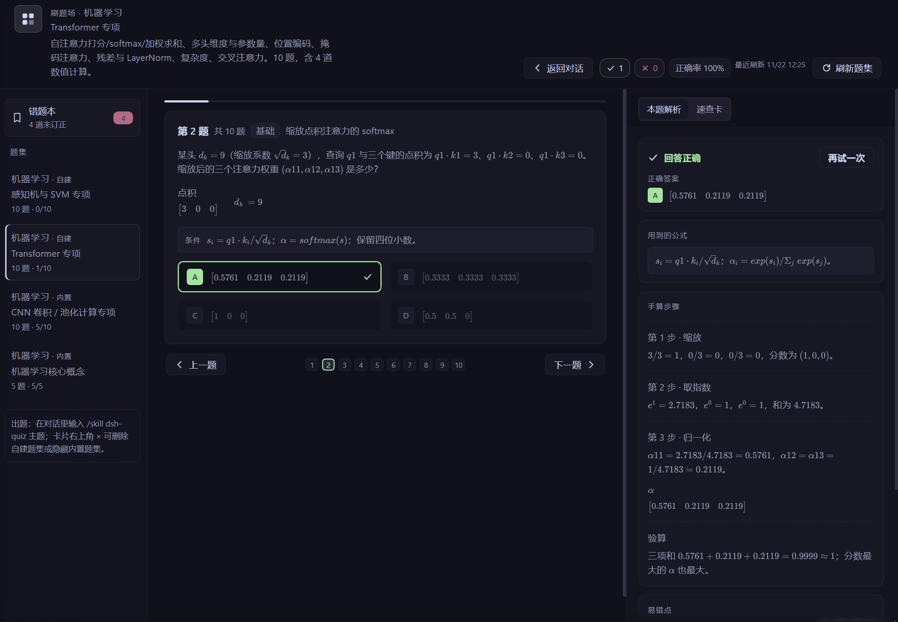

# dsh-quiz-tutorial

[中文](README.md) · English

A [DeepSeek Harness](https://github.com/deepseek-ai) plugin that turns review material into
practice decks: question on the left, a **hand-worked solution** on the right, a built-in
**mistake log**, and `/skill dsh-quiz` deck generation from the current review context.

<p align="center">
  
</p>

## Install

The package is published on npm:

```sh
dsh plugin --profile web add dsh-quiz-tutorial
```

Fallback (same package, installed from GitHub):

```sh
dsh plugin --profile web add github:xiaobin118/dsh-quiz-tutorial
```

Requires dsh web 0.2.0-rc.2 or newer (1.0.1 reuses dsh's `connection` trust fence on both web
routes, so the Host must provide that service). Restart `dsh web` once after installing (Host
routes and the skill do not hot-reload), then refresh the browser and open **Quiz** in the
sidebar. If you installed the earlier dev bundle `dsh-quiz`, remove it first
(`dsh plugin --profile web remove dsh-quiz`) so two bundles do not claim the same `quiz` panel.

## What it does

- **Decks**: switch decks in the sidebar; bundled CNN and ML concept decks, plus decks generated
  for any subject.
- **Question + solution**: matrices and 2–6 options; after answering, the aside shows the answer,
  the formula, step-by-step arithmetic with intermediate matrices, pitfalls, and why each wrong
  option is wrong.
- **Math rendering**: prompts/solutions/notes are rendered by DSH's KaTeX Markdown primitive —
  write LaTeX in `$...$` / `$$...$$` (`\frac`, `\sum`, `\mu_k`, `\hat{x}`, `\sigma^2`,
  `bmatrix`). No HTML is executed and remote images/links are dropped; legacy Unicode math in
  older decks is normalized to LaTeX on display.
- **Mistake log**: wrong answers are collected automatically; filter, review the solution, redo,
  mark fixed, or review all open mistakes in a queue. A correct retry marks the entry fixed.
- **`/skill dsh-quiz <topic>`**: the skill asks the agent to check existing decks, compute every
  answer and intermediate value, then save a validated deck via `quiz_save_deck`.
- **Delete / hide decks**: the × on a deck card deletes a custom deck (and clears that deck's
  local answers/mistakes/hidden flag); bundled decks are hidden and can be restored from the
  sidebar. Opening a mistake from a hidden deck restores that deck first.
- Keys `A–F` / `1–6` answer, `←` / `→` move between questions.

## Deck format

Decks are plain JSON. The file name must be `<id>.json`, one deck is capped at 512 KiB
(measured in bytes before writing), over-long fields fail with an error instead of being
silently truncated, and math must be LaTeX inside `$...$` / `$$...$$` (no Unicode math, no bare
`_`/`^`). See [docs/deck-format.md](docs/deck-format.md) and [skill.md](skill.md).

The numbers in the bundled decks — including every distractor — are computed and asserted by
[tools/gen_decks.py](tools/gen_decks.py), not typed by hand.

## Security

Both web routes call dsh's `connection.requestRejection(req)` before doing any work (Host/Origin
fence plus browser-session auth), reject a missing/empty `Host`, and require
`application/json` on the delete POST. Without a `connection` service the routes fail closed with
503 instead of serving decks anonymously. Deck text is rendered as React text only (the math
renderer never injects HTML); the plugin makes no external requests and reads no credentials.

## Development

DSH serves exactly one client bundle per package (`exports["./client"]`) and resolves `require`
only against its platform module table, so the client sources live in `client/src/*.js` and a
dependency-free script concatenates them into the served, checked-in `client.js`:

```sh
npm run build:client                 # rebuild client.js from client/src/*.js
npm run check                        # syntax check + assert client.js is in sync
npm test                             # node --test (no deps, no network)
python3 tools/gen_decks.py --check   # bundled decks match the generator
```

The 1.0.1 work also replaced the local Unicode math renderer with DSH's KaTeX Markdown primitive
(LaTeX-authored decks plus runtime normalization for legacy decks), made the refresh button report
added/updated decks and host errors visibly, and added regression tests for the trust fence, the
byte-size contract, deck validation bounds, refresh diffs, and the LaTeX normalizer.

## Contributing

Contributions are welcome: new-subject decks, UI, zh/en translations, Host code, docs, and bug
reports. Read [CONTRIBUTING.md](CONTRIBUTING.md); deck PRs must follow the "compute every answer
yourself" rule.

## License

[MIT](LICENSE)
