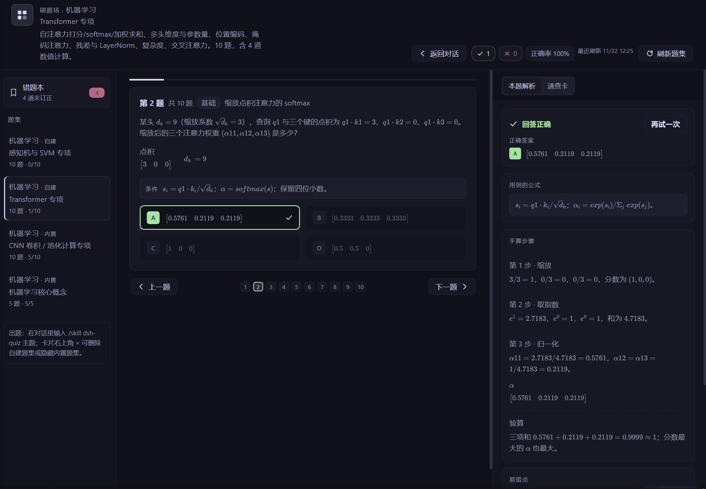

# dsh-quiz-tutorial · 刷题场

[English](README.en.md) · 中文

[](LICENSE)
[](https://github.com/topics/dsh-plugin)

一个 DeepSeek Harness（dsh）插件：把任意复习内容变成**题集**，在 Web UI 里逐题练习——
题目在左，**逐步手算解析**在右，答错的题自动进**错题本**，并支持用 `/skill dsh-quiz` 直接让
Agent 出题。

<p align="center">
  
</p>
<p align="center"><sub>用 <code>/skill dsh-quiz</code> 生成的「K-means 与 GMM 专项」题集；右侧是逐题手算解析。</sub></p>

## 功能

- **题集**：左侧列表切换；题集由 `/skill dsh-quiz` 或 `quiz_save_deck` 按当前复习内容生成，支持任意学科。
- **题目 + 解析**：矩阵输入、2–6 个选项；作答后右侧展开正确答案、用到的公式、
  **带中间矩阵的逐步手算**、易错点、每个错误选项的诊断。
- **公式渲染**：题面/解析/速查卡由 DSH 的 KaTeX Markdown 渲染器显示——用 `$...$` / `$$...$$`
  写 LaTeX（`\frac`、`\sum`、`\mu_k`、`\hat{x}`、`\sigma^2`、`bmatrix` 等）；不执行 HTML，
  远程图片/链接会被丢弃，旧题集里的 Unicode 数学会自动转成 LaTeX 兼容显示。
- **错题本**：答错自动收录（跨题集），支持筛选、看解析、重做、标记已订正、
  「重练全部未订正」队列；答对自动订正。
- **`/skill dsh-quiz` 出题**：在输入框输入 `/skill dsh-quiz 主题`，Agent 会查重、
  自己把答案和中间量算对，再保存成题集。
- **删除题集**：卡片右上角 × 真正删除（同时清掉该题集在本地的作答与错题记录）。
- **本地优先**：题集与作答/错题记录都在本机（题集在 `~/.dsh/dsh-quiz/decks/`，进度在
  localStorage），没有账号、没有遥测。
- 键盘 `A–F` / `1–6` 选答案，`←` / `→` 切题；深/浅色主题跟随宿主 token。

## 安装

需要 dsh web（0.2.0-rc.2 或更新；1.0.1 起两条 Web 路由复用 dsh 的 `connection`
信任栅栏，因此要求 Host 提供该服务）。包已发布到 npm：

```sh
dsh plugin --profile web add dsh-quiz-tutorial
```

备选安装方式（npm 不可用时从 GitHub 装同一个包）：

```sh
dsh plugin --profile web add github:xiaobin118/dsh-quiz-tutorial
```

> 如果装过早期的开发 bundle `dsh-quiz`，先移除它（`dsh plugin --profile web remove dsh-quiz`），
> 避免两个 bundle 注册同一个 `quiz` 面板。

装好后重启一次 `dsh web`（Host 侧的路由与技能不会热加载），刷新浏览器页面。
打开左侧栏的 **刷题场**。

> 如果是从仓库本地开发安装（`plugin_manager install_bundle` / 旧 `dsh-quiz` 包），
> 先移除旧 bundle 再装这个包，避免两个 bundle 注册同一个 `quiz` 面板。

## 用 /skill 出题

在对话输入框里：

```text
/skill dsh-quiz 自编码器与 VAE
```

技能会要求 Agent：

1. 先 `quiz_list_decks` 查重；
2. 设计 5–10 题，**自己算对**每道题的答案和全部中间量；
3. 用 `quiz_save_deck` 保存完整题集 JSON；
4. 提示你打开刷题场、点「刷新题集」。

<p align="center">
  
</p>
<p align="center"><sub><code>/skill dsh-quiz</code> 生成题集后，Agent 回报题表；打开刷题场刷新即可练习。</sub></p>

也可以直接对 Agent 说「用 quiz_save_deck 按刚才复习的内容出一套题」。

## 错题本

- 答错的题自动收录，记录错误次数、最近出错时间、上次错选项；
- 筛选「未订正 / 已订正 / 全部」；每题可 **看解析 / 重做 / 标记已掌握 / 移出**；
- **重练全部未订正**按最近出错顺序生成队列，答对自动标已订正，答错留在错题本；
- 「清空已订正」二次确认。

## 删除题集

鼠标移到左侧题集卡片上，右上角出现 **×**：

- 删除 `~/.dsh/dsh-quiz/decks/<id>.json`，不可恢复；
- 删除成功后该题集的作答与错题记录会一起清掉，不会污染之后同 id 的题集；
- 插件不预置内置题集，列表里所有题集都可以删除。

## 题集格式

题集是纯 JSON：`id / title / subject / description / notes / questions`，每道题包含
`prompt / inputs / options / answer / formula / steps / pitfall`。

- 文件名必须是 `<id>.json`；插件不预置内置题集，所有题集都由 Agent/用户创建；
- 单套题集序列化后 ≤ 512 KiB，保存前按字节检查，超限直接报错、不写文件；
- 字段超长会报错而不是静默截断；题目 id 重复会报错而不是改名；
- 公式必须写 LaTeX 并用 `$...$`（行内）/ `$$...$$`（独立）包住；不要用 Unicode 数学符号或裸
  `_`/`^`，新题集统一按 [docs/deck-format.md](docs/deck-format.md) 的 LaTeX 约定书写。

完整字段、约束、校验规则与公式写法见 [docs/deck-format.md](docs/deck-format.md)；
给 Agent 的出题规范见 [skill.md](skill.md)。

## 安全与隐私

- 两条 Web 路由（`GET /dsh-quiz/decks`、`POST /dsh-quiz/decks/delete`）在**任何**处理之前
  调用 dsh 的 `connection.requestRejection(req)`：Host/Origin 栅栏 + 浏览器会话校验；
  缺失/空 `Host` 直接拒绝，`POST` 必须是 `application/json`；
- 没有 `connection` 服务时路由 fail-closed（503），不会退化成匿名可读/可删；
- 题集内容只作为 React 文本渲染（公式渲染器同样不注入 HTML），插件不发外部请求、不读凭据、
  不做遥测。

```
index.js          Host：/dsh-quiz/decks 路由、三个 quiz_* 工具、dsh-quiz 技能注册
client.js         Web UI 的构建产物（DSH 只加载这一个文件，勿手改）
client/src/       Web UI 源码，按职责拆分：
                  base·locale·styles·text·math·state（宿主无关）
                  components·notebook·page·panel（React 组件与插件注册）
skill.md          /skill 出题规范
tools/build_client.mjs  把 client/src/*.js 拼成受版本控制的 client.js（无第三方依赖）
test/*.test.js    node:test 回归测试（题集、校验上限、存储契约、路由栅栏、客户端）
docs/             截图与题集格式文档
```

DSH 的客户端模块系统只服务每个包的一个 bundle（`exports["./client"]`），并且只把
`require` 解析到平台模块表，无法 import 包内相对模块，所以客户端源码在 `client/src/`、
运行产物仍是单个 `client.js`：

```sh
npm run build:client          # 改完 client/src/*.js 后重新生成 client.js
npm run check                 # 语法检查 + 确认 client.js 与源码同步
npm test                      # node --test（无依赖、无网络）
```

本地测试建议用单独的 dsh profile / DSH_HOME，避免影响日常会话。Host 代码更新后需要
重启 `dsh web`；只改 `client.js` 时刷新页面即可。

## 更新日志

### 1.0.3

- **移除内置题集**：包内不再带 `decks/`，刷题场初始为空；题集全部由 `/skill dsh-quiz` /
  `quiz_save_deck` 生成，或由用户写入 `~/.dsh/dsh-quiz/decks/`；
- 删除题集现在对所有题集可用；移除「隐藏 / 恢复内置题集」相关 UI 与本地状态；
- 删除内置题集的生成与校验脚本（`tools/gen_decks.py`），CI 不再跑生成校验。

### 1.0.2

- 矩阵改用 KaTeX `bmatrix` 渲染（括号与列对齐由 KaTeX 负责），不再用自绘 HTML 网格；
- 矩阵、输入与步骤中间量的标签、题集标题/学科、考点、难度、题面条件等所有题集内容都走同一套
  KaTeX 渲染，`卷积结果 C（$4\times4$）` 这类标签不会再显示成原始 `$...$`；
- 矩阵提供 `aria-label`（如「矩阵 [2, 4; 4, 3]」），KaTeX 的视觉输出对读屏器有纯文本替代。

### 1.0.1

安全与数据完整性修复（针对 1.0.0 的独立审计）：

- 两条 Web 路由接入 dsh 的 `connection` 信任栅栏（Host/Origin + 浏览器会话），空 `Host` 拒绝，
  `POST` 要求 `application/json`；没有 `connection` 时 fail-closed；
- 题集大小改为统一的字节契约：保存前超过 512 KiB 直接报错、不落盘，读取同样按字节判断；
- 文本字段超长改为**报错**而不是静默截断；题目 id 重复改为报错而不是静默改名；
- 文件名与 `<id>` 不一致的手写题集会被跳过并写进 `errors`，删除/列表/保存使用同一地址；
- 删除题集时清理它的作答、错题记录与隐藏标记；从错题本打开隐藏题集会先恢复显示；
- 题面/解析/速查卡的公式改为轻量渲染（`$...$`、`_{...}`/`^{...}`、`\frac`、希腊字母等），
  不再直接显示 `_{...}` 原文；`skill.md`、`docs/deck-format.md` 统一了写法约定；
- 修正 `skill.md` / `docs/deck-format.md` 的示例（2×2 输入却写 4×4 输出 + 池化的矛盾），
  示例改为完整可算的 1×1 结果；内置题集 `ml-cnn` 的干扰项改为脚本计算；
- 新增 `node:test` 回归测试与 CI（`npm run check`、`npm test`、生成脚本 `--check`）。

### 未发布的后续修复（1.0.1 内）

- 公式改用 DSH 的 KaTeX Markdown 渲染器（`MarkdownText`），题集按 LaTeX 书写；旧题集的 Unicode
  数学在渲染时自动规范化，内置题集与生成脚本已迁移为显式 LaTeX；
- 刷新按钮可见地报告结果：`已刷新：N 套题集（M 套用户题集） · 新增 X · 更新 Y`、无变化提示、
  最近刷新时间；宿主诊断/刷新失败改为可见的 `role="alert"` 横幅并提供重试；
- 修复 1.0.1 的打包遗漏（客户端源码、生成脚本与测试随包分发）与 reduced-motion CSS 层级错误。

## 贡献

欢迎任何形式的贡献：新学科题集、UI/交互、zh/en 翻译、Host 代码、文档、bug 报告。

- 提交前读 [CONTRIBUTING.md](CONTRIBUTING.md)；题集贡献请遵守
  [docs/deck-format.md](docs/deck-format.md) 与 [skill.md](skill.md) 的「答案必须自己算对」规则；
- 新功能先开 issue 或 discussion 说明场景，避免大改方向不一致；
- 市场条目/新题集/截图都欢迎 PR。

## License

[MIT](LICENSE)
