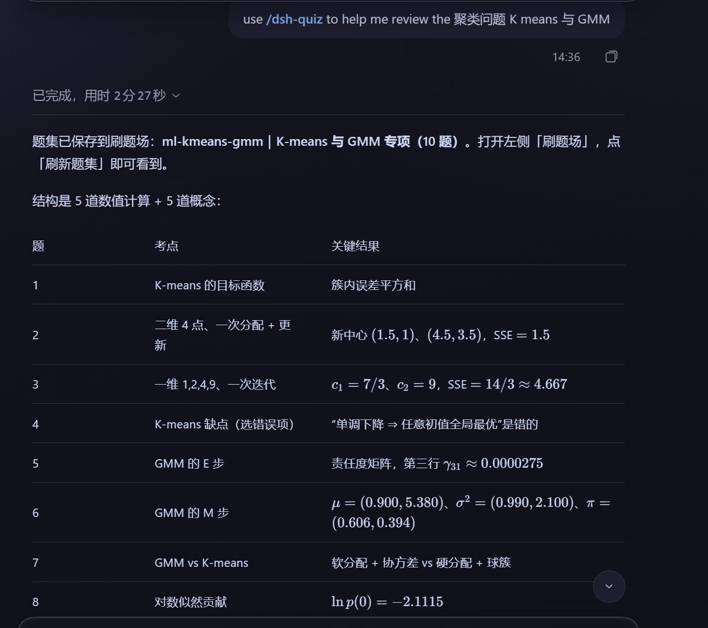

# dsh-quiz-tutorial · 刷题场

[English](README.en.md) · 中文

[](LICENSE)
[](https://github.com/topics/dsh-plugin)

一个 DeepSeek Harness（dsh）插件：把任意复习内容变成**题集**，在 Web UI 里逐题练习——
题目在左，**逐步手算解析**在右，答错的题自动进**错题本**，并支持用 `/skill dsh-quiz` 直接让
Agent 出题。

<p align="center">
  
</p>
<p align="center"><sub>用 <code>/skill dsh-quiz</code> 生成的「K-means 与 GMM 专项」题集；右侧是逐题手算解析。</sub></p>

## 功能

- **题集**：左侧列表切换；内置 CNN / 机器学习概念题，也可以按任意学科生成新题集。
- **题目 + 解析**：矩阵输入、A–D 选项；作答后右侧展开正确答案、用到的公式、
  **带中间矩阵的逐步手算**、易错点、每个错误选项的诊断。
- **错题本**：答错自动收录（跨题集），支持筛选、看解析、重做、标记已订正、
  「重练全部未订正」队列；答对自动订正。
- **`/skill dsh-quiz` 出题**：在输入框输入 `/skill dsh-quiz 主题`，Agent 会查重、
  自己把答案和中间量算对，再保存成题集。
- **删除 / 隐藏题集**：自建题集卡片右上角 × 真正删除；内置题集 × 隐藏，列表底部可恢复。
- **本地优先**：题集与作答/错题记录都在本机（题集在 `~/.dsh/dsh-quiz/decks/`，进度在
  localStorage），没有账号、没有遥测。
- 键盘 `A–D` / `1–4` 选答案，`←` / `→` 切题；深/浅色主题跟随宿主 token。

## 安装

需要 dsh web（本插件在 dsh 0.2.0-rc.2 上开发）。

先装 **GitHub 源**（npm 包名定为 `dsh-quiz-tutorial`（尚未发布））：

```sh
dsh plugin --profile web add github:xiaobin118/dsh-quiz-tutorial
```

> 如果之后 npm 上架，可以改用 `dsh plugin --profile web add dsh-quiz-tutorial`。

装好后重启一次 `dsh web`（Host 侧的路由与技能不会热加载），刷新浏览器页面。
打开左侧栏的 **刷题场**。

> 如果是从仓库本地开发安装（`plugin_manager install_bundle` / 旧 `dsh-quiz` 包），
> 先移除旧 bundle 再装这个包，避免两个 bundle 注册同一个 `quiz` 面板。

## 用 /skill 出题

在对话输入框里：

```text
/skill dsh-quiz 自编码器与 VAE
```

技能会要求 Agent：

1. 先 `quiz_list_decks` 查重；
2. 设计 5–10 题，**自己算对**每道题的答案和全部中间量；
3. 用 `quiz_save_deck` 保存完整题集 JSON；
4. 提示你打开刷题场、点「刷新题集」。

<p align="center">
  
</p>
<p align="center"><sub><code>/skill dsh-quiz</code> 生成题集后，Agent 回报题表；打开刷题场刷新即可练习。</sub></p>

也可以直接对 Agent 说「用 quiz_save_deck 按刚才复习的内容出一套题」。

## 错题本

- 答错的题自动收录，记录错误次数、最近出错时间、上次错选项；
- 筛选「未订正 / 已订正 / 全部」；每题可 **看解析 / 重做 / 标记已掌握 / 移出**；
- **重练全部未订正**按最近出错顺序生成队列，答对自动标已订正，答错留在错题本；
- 「清空已订正」二次确认。

## 删除 / 隐藏题集

鼠标移到左侧题集卡片上，右上角出现 **×**：

- **自建题集**：真正删除 `~/.dsh/dsh-quiz/decks/<id>.json`，不可恢复；
- **内置题集**：从列表隐藏，安装包里的文件不动；列表底部「恢复隐藏的题集（N）」恢复；
- 所有题集都隐藏时，主区域会显示恢复按钮。

## 题集格式

题集是纯 JSON：`id / title / subject / description / notes / questions`，每道题包含
`prompt / inputs / options / answer / formula / steps / pitfall`。

完整字段、约束和校验规则见 [docs/deck-format.md](docs/deck-format.md)；
给 Agent 的出题规范见 [skill.md](skill.md)。

内置题集的数字由 [tools/gen_decks.py](tools/gen_decks.py) 计算并断言选项唯一，
不是手抄的：

```sh
python3 tools/gen_decks.py   # 重新生成 decks/*.json 并打印每道题的答案
```

## 内置题集

- `ml-cnn`：CNN 卷积 / 池化计算专项（10 题，含单通道卷积、零填充、步长、多通道、
  ReLU、最大/平均/重叠/全局池化）
- `ml-core`：机器学习核心概念（5 题，过拟合、正则化、偏差-方差、precision/recall、数据泄漏）

## 开发

不需要构建，纯 ESM JavaScript：

```
index.js          Host：/dsh-quiz/decks 路由、三个 quiz_* 工具、dsh-quiz 技能注册
client.js         Web UI：题集列表、题目卡、解析侧栏、错题本、重练队列
decks/*.json      内置题集
skill.md          /skill 出题规范
tools/gen_decks.py  内置题集的生成与验算脚本
docs/             截图与题集格式文档
```

```sh
npm run check                 # node --check index.js && node --check client.js
python3 tools/gen_decks.py    # 可选：重新生成并校验内置题集
```

本地测试建议用单独的 dsh profile / DSH_HOME，避免影响日常会话。Host 代码更新后需要
重启 `dsh web`；只改 `client.js` 时刷新页面即可。

## 贡献

欢迎任何形式的贡献：新学科题集、UI/交互、zh/en 翻译、Host 代码、文档、bug 报告。

- 提交前读 [CONTRIBUTING.md](CONTRIBUTING.md)；题集贡献请遵守
  [docs/deck-format.md](docs/deck-format.md) 与 [skill.md](skill.md) 的「答案必须自己算对」规则；
- 新功能先开 issue 或 discussion 说明场景，避免大改方向不一致；
- 市场条目/新题集/截图都欢迎 PR。

## License

[MIT](LICENSE)
